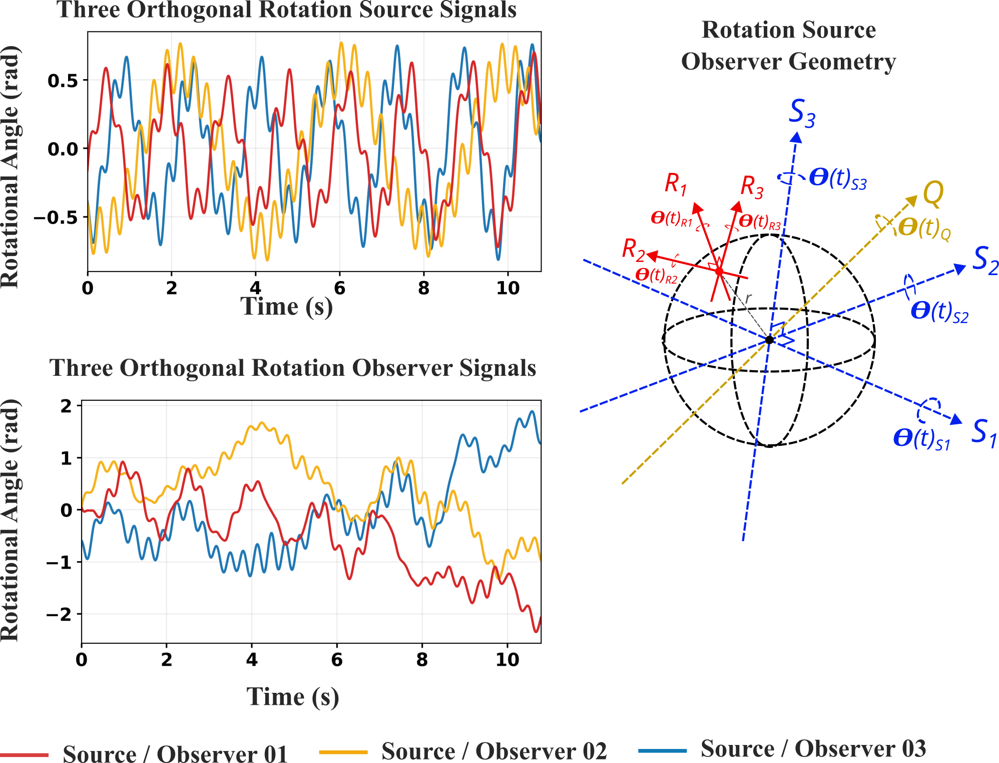
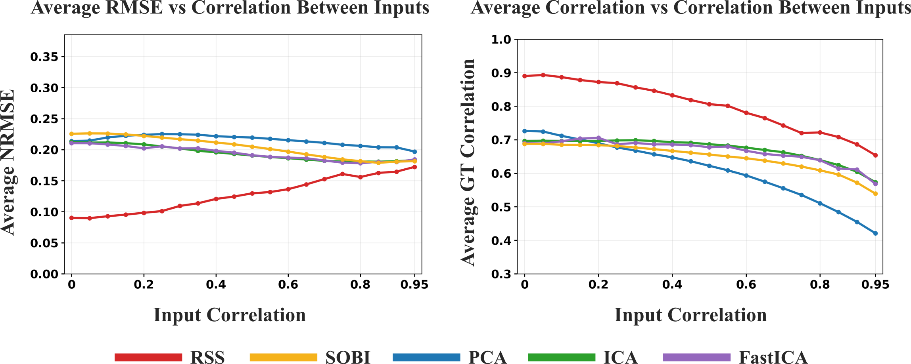
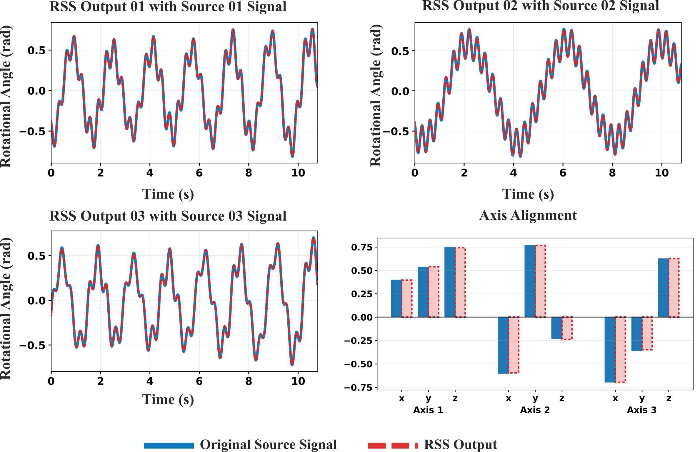

# RSS — Rotation Source Separation

Reference implementation of **Rotation Source Separation (RSS)**: recovering the latent rotations that were
compounded about mutually orthogonal axes and observed through an unknown, misaligned orthonormal frame — the
situation of a body-worn or robot-mounted IMU whose axes do not line up with the axes of the motion.

RSS keeps the geometry of rotations in the model. The resultant rotation is a unit quaternion; expressing its vector
part in the source and in the observer basis gives a *linear change of basis constrained to SO(3)*, parameterised by
**three rotation parameters** instead of the nine free entries of a generic BSS mixing matrix. The recovery matrix is
fitted with an objective built from a distinguishing property of the sources — in the letter, mutual uncorrelatedness
(zero-lag cross-correlation). This repository contains the solver, the synthetic and robot-arm (Quanser QArm)
validation, and a set of analysis tools — FFT / phase-portrait / classic gait features, Hilbert analysis, transfer entropy,
rotating Poincaré sections and an interactive dashboard — used to inspect RSS outputs on human-motion recordings.

<p align="center"></p>

## Contents

| # | Component | Where | Entry point |
| --- | --- | --- | --- |
| 1 | **RSS algorithm** and supporting code (solver, quaternion model, losses, SSA preprocessing, real-data pipeline) | [`rss/`](rss) | `python -m rss {validate,run-config,process-imu}` |
| 2 | **Simulation and validation**: synthetic suites, BSS baselines, correlation sensitivity, notebooks, paper tables and figures, **QArm practical validation** with data | [`rss/simulation.py`](rss/simulation.py), [`bss_baselines/`](bss_baselines), [`notebooks/`](notebooks), [`paper_figures/`](paper_figures), [`qarm_rss_experiments/`](qarm_rss_experiments), [`Sample_Data/QArm/`](Sample_Data) | notebooks; `python -m qarm_rss_experiments.reproduce_recommended_pipeline` |
| 3 | **Classic analysis**: FFT, phase portrait, PDF/CDF, classic temporal gait features | [`HMA_Dashboard/plotting.py`](HMA_Dashboard/plotting.py), [`gait_analysis/classical_features.py`](gait_analysis), [`notebooks/paper_plots.ipynb`](notebooks) | dashboard workbench; `python -m gait_analysis` |
| 4 | **Hilbert analysis**: analytic signal, instantaneous phase/frequency, completeness, segmentation, left/right pair test | [`hilbert_analysis/`](hilbert_analysis) | `python -m hilbert_analysis` |
| 5 | **Transfer entropy** | [`limb_transfer_entropy/`](limb_transfer_entropy), [`HMA_Dashboard/te_matrix.py`](HMA_Dashboard), [`gait_analysis/te_estimator.py`](gait_analysis) | `python -m limb_transfer_entropy` |
| 6 | **Poincaré map analysis** (rotating Poincaré section transform) | [`rotating_poincare/`](rotating_poincare) | `python -m rotating_poincare` |
| 7 | **HMA Dashboard** | [`HMA_Dashboard/`](HMA_Dashboard) (+ the `gait_analysis` package it imports) | `python -m HMA_Dashboard` |

There is no stand-alone FFT / phase-portrait module: those analyses live in the dashboard's plotting code, in
`rotating_poincare` (phase portraits) and in the notebooks. Each folder has its own README with the details.

## Installation

Python ≥ 3.10 (developed and tested on 3.11, Linux). From the repository root:

```bash
python -m venv .venv && source .venv/bin/activate     # or a conda environment
pip install -r requirements.txt
```

PyTorch is the only heavy dependency; install the build that matches your hardware from <https://pytorch.org> first if
you want a GPU (`compute_device` is `auto` / `cpu` / `cuda` / `cuda:<n>`).
Tested with PyTorch 2.11, NumPy 2.4, pandas 2.3, SciPy 1.17, scikit-learn 1.8, Dash 3.4, Plotly 6.7.

Run every command from the repository root; the packages are imported from the working directory.

## Quick start

### Synthetic validation

```bash
python -m rss validate --output-root outputs/rss_validation --epochs 500
```

generates one deterministic synthetic case (three sources with pairwise |ρ| < 0.01 composed as rotations, expressed in
random right-handed source and observer frames, and converted to body-fixed integrated-gyro observations), fits RSS, and
writes metrics (`metrics.json`), recovered-versus-true source plots, axis geometry and the loss history.

The same from Python:

```python
from rss import RSSConfig, SimulationConfig, generate_validation_scenario, run_validation_for_scenario

scenario = generate_validation_scenario(SimulationConfig(seed=0, T=2000))
config = RSSConfig(optimizer="adam", epochs=500, observer_signal_model="integrated_body_rotation")
result = run_validation_for_scenario(scenario, config)

print(result.metrics["mean_abs_source_correlation"])   # recovered vs. true sources (matched, sign-corrected)
print(result.rss_result.recovery_matrix)               # the fitted 3x3 SO(3) direction-cosine matrix
print(result.rss_result.source_angles.shape)           # (3, T) recovered source angles in radians
```

To fit your own three observer-angle signals directly, call `rss.fit_rss(observer_angles, RSSConfig(...))` with an array of
shape `(3, T)`.

### One rigidly mounted IMU (robot arm, single sensor)

```bash
python -m rss process-imu \
  --csv path/to/combined_log_wide_<timestamp>.csv \
  --node-prefix OrbiX-Node-10_IMU1 --gyro-units deg \
  --sample-rate-hz 100 --bias-window-seconds 1.0 \
  --rss-optimizer adam --disable-ssa-preprocessing --epochs 400
```

reads `<prefix>_GX/_GY/_GZ`, averages the first `--bias-window-seconds` (sensor stationary) as a static gyro bias,
integrates to three body-rotation channels, fits RSS and writes `source_1/2/3` to `<csv stem>_rss_sources.csv`. The full
recipe used for the QArm validation is in [`qarm_rss_experiments/README.md`](qarm_rss_experiments/README.md).

### Multi-segment human-motion recordings

```bash
python -m rss run-config --config config.example.json \
  --output-root outputs/rss --sample-rate-hz 100 --include-time-seconds \
  --rss-optimizer adam --rss-loss-type lagged_cross_correlation --rss-lags 0 --epochs 500
```

processes every file listed in the JSON config (`[{"csv_path": ..., "compute_device": "auto"}]`) — wide-format logs of the
multi-node IMU platform with columns `<device>_<IMU>_{AX,AY,AZ,GX,GY,GZ}`, mapped to the 18 body segments in
`rss/sensor_layout.py` — and writes, per recording, `limb_angle_mode.csv` (three RSS modes per segment plus
`*_original_angle`), `limb_axes_mode.csv`, `limb_quaternion.csv` and `limb_quaternion_axis_angle.csv`. Use
`--allow-partial-limbs` for incomplete sensor sets and repeatable `--enable-output` / `--disable-output` for extra
diagnostics. See [`rss/README.md`](rss/README.md) for every option.

## The method in brief

Three independent rotations about orthogonal source axes $S_1,S_2,S_3$ with angles $\theta_{S_i}(t)$ compound into one
rotation, $q_Q = q_{S_3}\otimes q_{S_2}\otimes q_{S_1}$, which the sensor reports as three angles
$\theta_{R_j}(t)$ about its own misaligned orthonormal axes $R_1,R_2,R_3$. The scalar part of the quaternion is the same in
both frames and the vector parts are related by

$$\begin{bmatrix}x_S\\y_S\\z_S\end{bmatrix}=A\begin{bmatrix}x_R\\y_R\\z_R\end{bmatrix},\qquad A_{ij}=\hat S_i\cdot\hat R_j,\qquad A\in SO(3),$$

so $A$ is a direction-cosine matrix: its entries are source/observer axis dot products. RSS parameterises it with a rotation
vector, $A(\boldsymbol\omega)=\exp([\boldsymbol\omega]_\times)$, $\boldsymbol\omega\in[-\pi,\pi]^3$ (Rodrigues' formula),
so $A^\top A=I$ and $\det A=1$ by construction. For a candidate $A$ the source angles are recovered from the quaternion
components $(w,x_S,y_S,z_S)$ and the optimiser minimises a separation objective. The letter uses mutually uncorrelated sources,

$$\mathcal L(A)=\tfrac13\bigl\|\operatorname{offdiag}(R_s(A))\bigr\|_F^2 ,$$

with $R_s$ the correlation matrix of the three recovered source angles (the code's default: lagged cross-correlation with
`lags=(0,)`). The implementation offers more than the letter describes:

* **Optimisers** — Adam (default), momentum SGD, or particle swarm (`--rss-optimizer {adam,sgd,pso}`), with an exponential learning-rate schedule.
* **Objectives** — lagged cross-correlation (multi-lag, SOBI-like); mutual information with GCMI, B-spline, KSG or soft-histogram estimators; torsional rotational action.
* **Adaptive specialized regularizers** — harmonic spectral overlap, filtered multi-lag cross-correlation, chirp time-frequency overlap and piecewise sparse innovation, ramped on and off after loss plateaus (`--rss-adaptive-regularizer`; formulation in [`docs/RSS_Specialized_Losses_Formulation.pdf`](docs/RSS_Specialized_Losses_Formulation.pdf)).
* **Optional** quaternion-reconstruction constraint, periodic proper-axis flip search, SSA drift/noise preprocessing for real recordings, and the legacy six-parameter symmetric mixing matrix.

The solver code is `rss/solver.py` (fit, losses, optimisers) on top of `rss/model.py` (quaternion composition and basis change).

## Validation and reproducing the paper

All synthetic scenarios are generated from fixed seeds, so the experiments are exactly repeatable.

**Synthetic study** — four signal families (harmonic, filtered noise, chirp-modulated, piecewise transient), 50 cases each
(200 total), three sources per case, 720–1080 samples at 100 Hz, three amplitude tiers (0.22–1.30 rad), pairwise |ρ| < 0.01.
[`notebooks/rss_validation.ipynb`](notebooks/rss_validation.ipynb) runs it for RSS and for the PCA / JADE-ICA / FastICA / SOBI
baselines in [`bss_baselines/`](bss_baselines); [`notebooks/rss_validation_specialized_losses.ipynb`](notebooks/rss_validation_specialized_losses.ipynb)
adds the family-matched specialized losses. Set `QUICK_MODE = True` for a smoke run; the full study takes hours.

**Correlation sensitivity** — the same study with the decorrelation constraint replaced by an exact equicorrelation ρ ∈ {0, 0.05, …, 0.95}
(20 levels × 4 families × 10 replicates = 800 cases; `paper_figures/run_linear_correlation_sweep.py`, the grid of the letter's
figure — the notebooks sweep a 10-level logarithmic grid instead): RSS depends on source independence, and its advantage over
the baselines shrinks as ρ grows.

<p align="center"></p>

**QArm practical validation** — a gripper/wrist-mounted IMU on a Quanser QArm following random multisine joint
trajectories, with encoder ground truth (`Sample_Data/QArm`, 65 usable tests from two sessions). Reproduce the whole analysis in about two minutes:

```bash
python -m qarm_rss_experiments.reproduce_recommended_pipeline
```

**Paper tables** (letter, Table I; mean absolute correlation with the ground-truth sources):

| | n | RSS | PCA | ICA | FastICA | SOBI |
| --- | ---: | ---: | ---: | ---: | ---: | ---: |
| Harmonic | 50 | **0.889** | 0.683 | 0.655 | 0.649 | 0.641 |
| Filtered noise | 50 | **0.891** | 0.712 | 0.682 | 0.679 | 0.708 |
| Chirp modulated | 50 | **0.865** | 0.608 | 0.575 | 0.559 | 0.603 |
| Piecewise transient | 50 | **0.928** | 0.759 | 0.748 | 0.751 | 0.743 |
| QArm (best 30 of 65) | 30 | **0.961** | 0.656 | 0.666 | 0.656 | 0.653 |

Four things to know when you use or quote these numbers:

* The RSS entries of the four simulated families are the **family-matched specialized-loss** variant
  (`rss_specialized`), not plain zero-lag cross-correlation. See [`paper_figures/README.md`](paper_figures/README.md).
* The QArm entry is the **best 30 of 65 trials**, selected by RSS's own correlation with the encoder ground truth; over
  all 65 trials RSS reaches a mean |r| of **0.807** (0.942 on the 2026-09-09 session, 0.651 on the 2026-09-18 session). The baselines
  were scored on the same 30 windows. See [`qarm_rss_experiments/README.md`](qarm_rss_experiments/README.md).
* The QArm recipe is Adam with SSA preprocessing off and the `piecewise_sparse_innovation` adaptive regularizer, not the
  PSO + plain cross-correlation objective described in the letter's algorithm section.
* Only the 2026-09-18 QArm session used decorrelated joint trajectories. In the 2026-09-09 session — 29 of the 30 best trials — the
  measured joint angles are strongly correlated (median per-test maximum pairwise |ρ| 0.59, up to 0.94), so the "sources
  kept uncorrelated" condition does not hold for most of the QArm column. Details in the QArm README.

[`paper_figures/`](paper_figures) regenerates the tables and figures from stored results. Tests:
`python -m pytest tests` (see [Tests](#tests)).

<p align="center"></p>

## Analysis tools for RSS outputs

RSS writes one `limb_angle_mode.csv` per recording. Three modes per body segment are returned; their **signs are a free gauge**
(the pipeline does not canonicalise them, so a substantial fraction of the signals come out inverted), and correctness is a property of
a left/right *pair* — the same waveform half a stride apart — not of a single signal. The tools below work on those files.
To try them without human data, generate synthetic outputs first:

```bash
python scripts/make_demo_outputs.py --output-root outputs/rss/Demo_Synthetic
```

### 3. Classic analysis — FFT, phase portrait, distributions, gait features

The [dashboard](#7-hma-dashboard) workbench draws, for any recovered signal or a pair of signals: time series, **FFT**,
PDF/CDF, **phase portrait** `[x(t), dx/dt]`, the Poincaré transform, the Hilbert analytic signal, instantaneous phase and
frequency, joint PDF and transfer entropy. `rotating_poincare` writes phase portraits to disk, and
`notebooks/paper_plots.ipynb` produces the PDF/CDF figures of the letter. Classic temporal gait features (step timing,
bilateral symmetry) come from `gait_analysis/classical_features.py`; see [`gait_analysis/README.md`](gait_analysis/README.md)
for the `python -m gait_analysis` workflow.

### 4. Hilbert analysis

```bash
python -m hilbert_analysis --input-root outputs/rss/Demo_Synthetic            # dry run: reports only
python -m hilbert_analysis --input-root outputs/rss/Demo_Synthetic --apply    # add segment/cycle columns, move incomplete recordings (backup first)
```

Analytic signal, envelope, instantaneous phase and frequency (`hilbert_analysis.analytic`), plus a batch pipeline that
detects truncated recordings, tests every left/right pair for inversion with a half-stride-lag cross-correlation (reported by
default; rewriting signs needs `--legacy-pair-flip`), and labels segments and gait cycles. Reports go to
`outputs/hilbert_analysis/`. Details and the criteria that were tried and
rejected: [`hilbert_analysis/README.md`](hilbert_analysis/README.md).

### 5. Transfer entropy

```bash
python -m limb_transfer_entropy --input-root outputs/rss --output-root outputs/limb_transfer_entropy --bins 8
```

Discrete plug-in transfer entropy (bits) between the four mode-1 segment signals of each leg (pelvis→hip→knee→ankle→foot),
written as matrices, edge tables and plots. The dashboard adds a full-body segment TE matrix. Note that the plug-in estimate
is strongly biased upward when the joint state space is large against the sample count (see the caution in
[`HMA_Dashboard/README.md`](HMA_Dashboard/README.md)). [`limb_transfer_entropy/README.md`](limb_transfer_entropy/README.md).

### 6. Poincaré map analysis

```bash
python -m rotating_poincare --input outputs/rss/Demo_Synthetic/…/limb_angle_mode.csv \
  --signal-cols left_hip_to_knee_mode_1 --output-dir outputs/rotating_poincare
python -m rotating_poincare --demo
```

Sweeps a full circle of section lines through the phase portrait of a joint-angle signal and histograms the crossings
radially, giving a stability/repeatability fingerprint (counts matrix, per-section statistics, heatmap, static and
interactive 3-D surfaces). Descriptive, not a proof of periodicity. [`rotating_poincare/README.md`](rotating_poincare/README.md).

### 7. HMA Dashboard

```bash
python -m HMA_Dashboard --results-dir outputs --port 8050
```

Interactive browser for RSS output folders: the signal workbench above, hierarchical subject/terrain/activity/trial selection,
mode browsing and CSV export, reference-guided orientation checks with transactional sign-flip saving, faulty-signal reports,
and a **Data & Runs** tab that uploads raw IMU CSVs and launches `python -m rss run-config`. The server has no authentication —
keep it on `127.0.0.1`; `--read-only` hides the upload/run tab (flip saves and logs can still write). [`HMA_Dashboard/README.md`](HMA_Dashboard/README.md).

## Repository layout

```text
rss/                    1  the RSS algorithm: solver, quaternion model, losses, SSA, simulation, evaluation,
                           recorded-IMU pipeline (sensor layout, CSV input, exporters), CLI
bss_baselines/          2  PCA, JADE-ICA, FastICA, SOBI baselines and the correlation-sensitivity sweep
notebooks/              2  validation notebooks (zero-lag and specialized losses) and the paper-plot notebook
paper_figures/          2  scripts and outputs for the letter's tables and figures
qarm_rss_experiments/   2  QArm practical validation: analysis code, hardware runners, signal bank, reference results
Sample_Data/            2  raw recordings: QArm/ is included; Human_Motion/ is where your own recordings go
hilbert_analysis/       4  Hilbert-transform toolkit and the batch cleaner for RSS outputs
limb_transfer_entropy/  5  within-limb transfer entropy of RSS outputs
rotating_poincare/      6  rotating Poincaré section transform
HMA_Dashboard/          7  Dash application for browsing and checking RSS outputs
gait_analysis/          3,7 gait events, classic features, FPCA, transfer-entropy networks, reference registry (used by the dashboard)
scripts/                   demo-output generator and the formal loss-comparison job
tests/                     unit tests for everything above (tests/gait_analysis for the gait package)
docs/                      figures from the letter, specialized-loss formulation, gait methodology, axis-flip report
config.example.json        template for `python -m rss run-config`
```

(The numbers refer to the components in the table at the top.)

## Tests

```bash
python -m pytest tests
```

The suite covers the solver, simulation and notebook (an end-to-end quick-mode execution of `rss_validation.ipynb`), baselines, the
correlation-sensitivity study, the QArm tooling, all analysis packages and the dashboard. The full run (346 tests: 340 pass, 6 skip) takes
about a minute and a half on a multi-core CPU. The skipped tests need optional material that is not distributed (labelled gait samples, a real outputs tree). None needs hardware or the QUARC API.

## Data and privacy

Only the QArm recordings (no human participants) are distributed. No human-motion recordings are included; the dashboard
and tools run on synthetic demo outputs or on your own data in the layout described in
[`Sample_Data/README.md`](Sample_Data/README.md).

## Known limitations

* **Source independence is an assumption.** With the zero-lag cross-correlation objective, accuracy degrades as the true
  sources become correlated (see the sensitivity study); the objective should be matched to the property that actually
  distinguishes the sources in your application — that is what the specialized losses and MI/action objectives are for.
* **Sign and ordering are not identifiable.** Signs are whatever the optimiser converged to and modes keep the optimiser's
  order unless `--rss-mode-order amplitude` is given; use pair tests or a reference to fix signs (`hilbert_analysis`, dashboard).
* **Axes are in the sensor frame.** Recovered axes are expressed in the raw IMU frame; no anatomical calibration is applied.
* **Geometry matters.** A rank-deficient rig (e.g. two parallel joints seen by one IMU) is not an identifiable three-source separation.
* Mode 1 of an RSS segment is a latent motion proxy, not a validated anatomical joint angle.

## Citation

If you use this code, please cite the letter (GitHub's "Cite this repository" button reads [`CITATION.cff`](CITATION.cff)):

```bibtex
@article{navarathne_rss,
  title   = {{RSS}: Rotation Source Separation},
  author  = {Navarathne, Tharinda and Adhikari, Sachintha and Meghapathirana, Nadeera and Godaliyadda, Roshan and Ekanayake, Parakrama},
  journal = {IEEE Signal Processing Letters},
  year    = {TODO},
  note    = {TODO: volume, pages, DOI}
}
```

## License

Released under the [MIT License](LICENSE).
